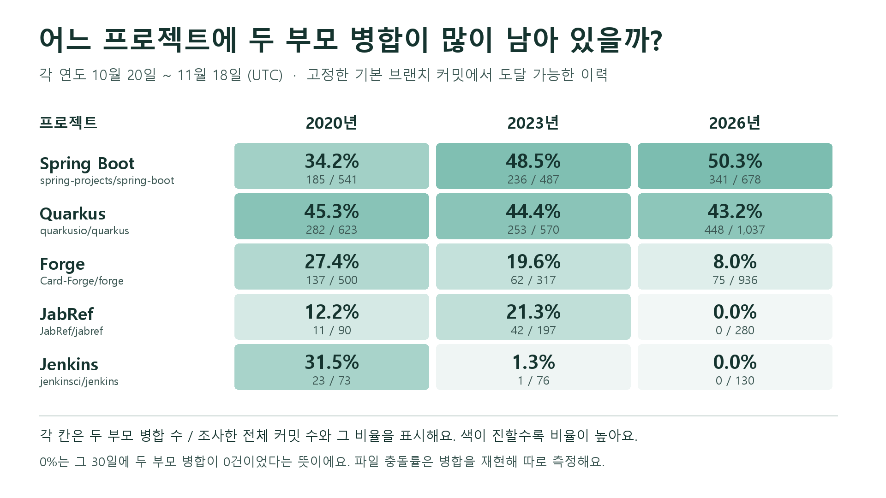

# Java 병합 충돌 예측 데이터 후보 조사

조사일 2026-11-19(한국), 전처리기 [`06e755eb`](https://github.com/AIX-APLUS/aix-preprocessor/commit/06e755ebabed1707a3413ec99ffa2511b046c543), 연구 브랜치 `research/dataset-repository-audit`. 조사 시작 시 원격 main과 Sprint 0 기준 커밋이 일치했다. Card Forge는 팀이 지정한 카드 게임 규칙 엔진이다. [정량 비교 JSON](repository-suitability.json) · [재현 명령](../../research/repository-audit/REPRODUCE.md) · [레이블과 분할 구현](method.md) · [라이선스 근거](identity-license.md)

## 고정 입력과 규모

기본 브랜치에서 양쪽 부모를 따라 도달 가능한 전체 커밋을 집계했다. Java 규모는 커밋에 들어 있는 소문자 `.java` blob 경로 수다. GitHub의 저장소 크기는 서버 메타데이터(KiB)다. 전체 분석의 필요 디스크나 최대 메모리와 구별한다. 공개 heads/tags의 이름과 객체 SHA는 보존했다. 저장소가 만들어지기 전에 작성된 커밋도 이관된 이력에 존재한다. [고정 tip과 트리 조회](../../research/repository-audit/evidence/github-default-evidence.json) · [공개 refs 기록](../../research/repository-audit/evidence/api-refs/inventory.json)

| 저장소 | 고정 기본 브랜치 | 도달 커밋 | Java 경로 | GitHub 크기(KiB) | heads / tags | 현재 루트 라이선스 |
|---|---|---:|---:|---:|---:|---|
| [Spring Boot](https://github.com/spring-projects/spring-boot) | `main@dd87919e` | 64,085 | 8,729 | 226,975 | 27 / 399 | Apache-2.0 |
| [Jenkins](https://github.com/jenkinsci/jenkins) | `master@e8ba485c` | 38,921 | 1,988 | 174,915 | 55 / 1,943 | MIT |
| [Card Forge](https://github.com/Card-Forge/forge) | `master@9748ef2c` | 76,296 | 2,919 | 1,094,914 | 145 / 197 | GPLv3 |
| [JabRef](https://github.com/JabRef/jabref) | `main@75b35b96` | 25,390 | 3,290 | 289,139 | 101 / 66 | MIT |
| [Quarkus](https://github.com/quarkusio/quarkus) | `main@61d97188` | 64,169 | 23,762 | 550,560 | 132 / 535 | Apache-2.0 |

## 같은 계절, 다른 병합 이력

고정 SHA의 API 커밋 목록 마지막 페이지에서 확인한 루트와 tip의 커밋 연도는 Spring Boot 2012–2026, Jenkins 2006–2026, Card Forge 2011–2026, JabRef 2003–2026, Quarkus 2018–2026이다. 여러 루트가 있을 수 있어 목록의 마지막 커밋 날짜가 프로젝트의 최초 개발일임을 보장하지 않는다.

각 연도 **10월 20일~11월 18일 UTC**에 해당하는 고정 tip 도달 커밋을 GitHub REST에서 마지막 페이지까지 읽었다. 셀은 **두 부모 병합 수 / 해당 기간 전체 커밋 수**다. 15개 구간에서 6,535개를 조사했고 세 부모 이상인 커밋은 없었다. 세 기간은 프로젝트 수명 전체의 무작위 표본이 아니다. [과거 구간](../../research/repository-audit/evidence/historical-parent-counts.json) · [최근 구간](../../research/repository-audit/evidence/recent-parent-counts.json)

| 저장소 | 2020 | 2023 | 2026 |
|---|---:|---:|---:|
| Spring Boot | 185 / 541 | 236 / 487 | 341 / 678 |
| Jenkins | 23 / 73 | 1 / 76 | 0 / 130 |
| Card Forge | 137 / 500 | 62 / 317 | 75 / 936 |
| JabRef | 11 / 90 | 42 / 197 | 0 / 280 |
| Quarkus | 282 / 623 | 253 / 570 | 448 / 1,037 |

Card Forge의 최근 구간에는 75개 병합이 있었다. 한편 실제 병합된 PR #12942·#12931·#12816의 결과 커밋은 모두 부모가 하나였고 원래 PR HEAD는 그 부모에 포함되지 않았다. Jenkins와 JabRef도 표본 PR 3개씩이 단일 부모였다. Spring Boot와 Quarkus는 PR 3개씩 모두 결과의 두 부모 중 하나가 PR HEAD였다. 이 15개 REST 응답은 squash/rebase 방식을 명시하지 않는다. 단일 부모가 관측된 과거 PR별 사용 방식을 확정하거나 저장소 전체의 비율을 추정할 수 없다. [PR별 SHA와 직접 근거](../../research/repository-audit/evidence/github-metadata.json)

## 병합이 Java 파일 후보로 이어지는지

세 조사 기간 중 두 부모가 8개 이상인 가장 최근 기간에서 API 순서로 8개씩 골랐다. GitHub Compare의 양방향 변경 목록을 대조하고 겹친 경로는 base와 양쪽 부모의 파일 모드와 blob ID를 확인했다. 300개 파일 제한에 걸린 비교 7건은 반대쪽의 완전한 목록·파일 객체로 점검했다. 기간이 다르고 시간상 가까운 사례들이므로 저장소 전체의 수율로 일반화할 수 없다. [비교 대상 40개와 경로별 증거](../../research/repository-audit/evidence/recent-overlaps.json)

| 저장소 | 사용 연도 | 실제 병합 | 양쪽 수정 Java 파일 발생 건수 |
|---|---:|---:|---:|
| Spring Boot | 2026 | 8 | 0 |
| Jenkins | 2020 | 8 | 0 |
| Card Forge | 2026 | 8 | 1 |
| JabRef | 2023 | 8 | 0 |
| Quarkus | 2026 | 8 | 2 |

위 세 건의 실제 Java 파일은 base·부모 두 개의 Git blob SHA를 검증한 후 Git 2.55.0.windows.5에서 `git merge-file --stdout`으로 따로 병합했다. 세 파일 모두 종료 코드 0이었다. 이 확인으로 단순한 동시 수정이 곧 충돌이라는 해석을 배제할 수 있다. 트리 전체의 속성, 비텍스트 충돌, 이력 통계 등을 검사하는 생산 전처리기 결과는 별도 항목이다. [파일별 명령·객체 ID·종료 코드](../../research/repository-audit/evidence/file-merge-probe.json)

## 데이터 이용과 모델 평가

### 생산 전처리기와 파일럿의 확인 범위

정량 파일에서 `total_commits`는 고정 기본 브랜치, `eligible_samples`와 양성·음성은 기록된 별도 파일럿 ref 기준으로 읽는다. `null`은 미측정이다. 이력 전체의 유효 행·충돌 양성 수를 커밋 수나 특정 기간의 병합률로 환산하지 않는다.

기준 Java 소스는 로컬 JDK 17에서 컴파일했고 기존 파일로 `stats`도 확인했다. Windows 격리 환경에서 `extract`는 Git의 임시 미러 생성 중 exit 128로 중단됐다. 다섯 후보를 위한 별도 Ubuntu 실행 설정과 각 단계의 재현 경로를 제공한다. [로컬 실행 기록](local-probe.md) · [Ubuntu 연구 실행](../../.github/workflows/repository-suitability-study.yml)

### 학습·성능 목적과 데이터 선택

| 목적 | 우선순위와 근거 |
|---|---|
| 학습 데이터 확보 | JabRef를 먼저 재현할 근거는 팀 PR에서 보고한 2,625행 중 양성 680행이다. 해당 결과의 원본 SHA·refs가 공개되지 않아 여기서 동일한 충돌률을 가정하지 않는다. Quarkus와 Card Forge는 서로 다른 도메인에서 실제 동시 수정 경로가 확인된 조합이다. 먼저 기간별 양성과 고유 경로·병합 수를 확인한다. Spring Boot는 최근 병합이 많으나 조사한 8개에는 겹치는 Java 경로가 없었다. Jenkins는 과거 이력을 우선한다. 다섯 곳 일괄 채택은 보류한다. [JabRef 팀 보고](https://github.com/AIX-APLUS/aix-preprocessor/pull/1) |
| 처리 성능 | 규모 상한을 보는 대상은 Quarkus(23,762 Java 경로·최근 448개 병합)와 Card Forge(76,296 커밋·GitHub 크기 약 1.04 GiB)다. Spring Boot는 최근 병합이 많은 또 다른 프레임워크, JabRef는 과거 자료와의 교차검사, Jenkins는 상대적으로 작은 Java 트리·많은 태그를 가진 대조군이다. 실제 초당 처리량·최대 메모리 순위는 통제된 동일 범위에서 비교해야 한다. |

대형 파일·rename이 실제 병목인지, 그 빈도가 어느 저장소에서 높은지는 전체 조사 전 미확정이다. 데이터가 확보되면 학습에는 도메인이 다른 적어도 두 곳을 두고, 세 번째 이상의 충분한 양성·음성 보유 저장소를 통째로 떼어 외부 평가에 쓴다. 내부 검증 성능으로 외부 저장소 성능을 대체하지 않는다.

- 추출 행에는 **과거 Java 소스 전문**이 들어간다. 현재 MIT인 JabRef의 v2.11 실제 Java 헤더에서 GPL-2.0-or-later를 확인했다. 과거 Card Forge/JabRef 행까지 한 가지 라이선스로 공개하는 방식은 피한다. 재배포 전 `base_sha + base_path`에서 적용 조건과 고지문을 추적한다. 발표에는 집계표와 원본 링크를 사용할 수 있다. [실제 JabRef 파일](https://github.com/JabRef/jabref/blob/4bdf5e142511278d8dd2a466bf611994caf4d091/src/main/java/net/sf/jabref/JabRef.java) · [저장소별 이용 조건](identity-license.md)
- 모델의 세 입력(코드, 코드+이력, 이력)은 동일한 행·분할·평가 기준을 사용한다. 각 저장소의 완전한 입력을 먼저 `merge`한 뒤 `split`하는 전략 A를 기본으로 둔다. 경로 그룹을 저장소별로 배정하는 구현상 저장소별 완전한 입력을 나눠 처리한 전략 B와 동일한 멤버십이 예상된다. 한 저장소를 시대별 조각으로 먼저 분할하면 이 성질이 깨질 수 있다. [구현과 전제](method.md)
- 저장소별 양성 수·고유 경로·서로 다른 양성 병합 수를 기준으로 훈련 비중을 조절한다. 평가는 원래 분포를 유지하고 저장소별 정밀도·재현율·PR-AUC를 함께 제시한다. 같은 경로를 보호한 뒤에도 rename, 복제, 같은 병합의 여러 파일, 가까운 시기의 변경이 다른 분할에 남을 수 있다. 별도의 저장소 전체 holdout과 시간순 평가를 두고 세 모델에 그대로 적용한다.

## 추가 후보

팀 지정 다섯 곳과 별도로 Jackson Databind, Mockito, GraphHopper, JGraphT, Kafka의 세 시점에서 총 375개 커밋을 살펴봤다. **추가 추출을 먼저 시도할 후보는 Jackson Databind**다. 조사한 각 25개 커밋에서 두 부모 병합이 12·6·4개였고, 최근 병합 5개 중 2개에서 양쪽이 수정한 동일 Java 경로가 최소 3건이었다. 한 경로가 반복됐고 실제 유효 행·양성률은 아직 측정하지 않았다. [추가 후보 비교와 선별 근거](supplementary-screen.md)

## 발표용 설명

팀원 둘이 같은 문서를 편집하더라도 서로 다른 문단을 고치면 두 변경을 그대로 담을 수 있다. 서로 다른 방식으로 같은 구절을 고치면 누군가 선택해야 한다. 이 프로젝트는 그 일이 과거 Java 파일에서 실제로 일어났는지 Git으로 재현한다. 변경 기록이 수만 건이어도 두 버전의 병합과 같은 파일의 양쪽 변경이 있어야 학습 사례 하나가 생긴다. 충돌한 경우와 깨끗하게 합쳐진 경우를 함께 보여줘야 모델이 무조건 한쪽으로만 답하는지 알아낼 수 있다.

카드 게임 엔진·참고문헌 관리 도구·서버 프레임워크를 나누어 보는 이유는 팀마다 자주 바꾸는 코드와 합치는 방식이 다르기 때문이다. 특정 팀의 작업 습관을 외운 모델인지 확인하려면 한 프로젝트를 통째로 빼 두었다가 마지막에 시험한다. 발표에서는 먼저 같은 기간의 두 부모 병합 비중을 보여 주고, 다음 표에서 실제 추출된 행 중 충돌·비충돌 수를 각각 제시한다. 두 표의 분모를 꼭 표시한다.
