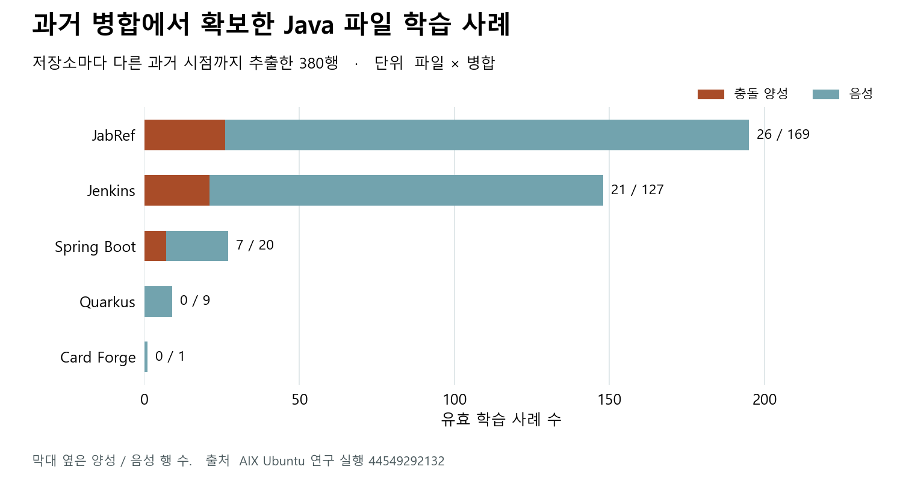

# Java 병합 충돌 예측 데이터 후보 조사

**다음 수집 실험은 JabRef와 Jenkins를 우선 추천한다.** 2015년까지의 JabRef 표본은 195행·양성 26행(16개 병합), 2011년까지의 Jenkins 표본은 148행·양성 21행(13개 병합)이었다. 과거 원문 사용 범위를 정한 뒤 두 곳을 같은 기준으로 확장해 양성이 계속 확보되는지 확인한다. 전체 저장소의 수율 순위와 최종 학습·테스트 구성은 아직 정할 수 없다. 성능 시험의 첫 후보는 Quarkus, 큰 파일과 오래된 이력의 부하는 Card Forge에서 점검한다. [독립 리뷰 대응과 재현 결과](claude-review-response.md)

2026-11-20 한국 기준. 대상 전처리기는 [`06e755eb`](https://github.com/AIX-APLUS/aix-preprocessor/commit/06e755ebabed1707a3413ec99ffa2511b046c543), 최초 실측은 [`a6a7c7ea` · Ubuntu run 44549292132](https://github.com/AIX-APLUS/aix-preprocessor/actions/runs/44549292132)에서 얻었다. 수정 후 [`4b623d55` · Ubuntu run 44579446949](https://github.com/AIX-APLUS/aix-preprocessor/actions/runs/44579446949)에서 380행과 저장소별 논리 해시 5개가 재현됐다. [두 실행의 비교와 Artifact 명세](final-ci-validation.md) 팀 지정 후보 5곳은 실제 전처리기로, 그 밖의 10곳은 고정 시점의 GitHub 이력과 파일 조사로 평가했다. Card Forge는 카드 게임 규칙 엔진이다. [정량 JSON](repository-suitability.json) · [원본 대조 기록](../../research/repository-audit/evidence/run-44549292132-provenance.json) · [재현 방법](../../research/repository-audit/REPRODUCE.md)

## 고정 입력과 규모

기본 브랜치에서 양쪽 부모를 따라 도달 가능한 전체 커밋을 집계했다. Java 규모는 커밋에 들어 있는 소문자 `.java` blob 경로 수다. GitHub의 저장소 크기는 서버 메타데이터(KiB)다. 전체 분석의 필요 디스크나 최대 메모리와 구별한다. 공개 heads/tags의 이름과 객체 SHA는 보존했다. 저장소가 만들어지기 전에 작성된 커밋도 이관된 이력에 존재한다. [고정 tip과 트리 조회](../../research/repository-audit/evidence/github-default-evidence.json) · [공개 refs 기록](../../research/repository-audit/evidence/api-refs/inventory.json)

| 저장소 | 고정 기본 브랜치 | 도달 커밋 | Java 경로 | GitHub 크기(KiB) | heads / tags | 현재 루트 라이선스 |
|---|---|---:|---:|---:|---:|---|
| [Spring Boot](https://github.com/spring-projects/spring-boot) | `main@dd87919e` | 64,085 | 8,729 | 226,975 | 27 / 399 | Apache-2.0 |
| [Jenkins](https://github.com/jenkinsci/jenkins) | `master@e8ba485c` | 38,921 | 1,988 | 174,915 | 55 / 1,943 | MIT |
| [Card Forge](https://github.com/Card-Forge/forge) | `master@9748ef2c` | 76,296 | 2,919 | 1,094,914 | 145 / 197 | GPLv3 |
| [JabRef](https://github.com/JabRef/jabref) | `main@75b35b96` | 25,390 | 3,290 | 289,139 | 101 / 66 | MIT |
| [Quarkus](https://github.com/quarkusio/quarkus) | `main@61d97188` | 64,169 | 23,762 | 550,560 | 132 / 535 | Apache-2.0 |

## 같은 계절, 다른 병합 이력

고정 SHA의 API 커밋 목록 마지막 페이지에서 확인한 루트와 tip의 커밋 연도는 Spring Boot 2012–2026, Jenkins 2006–2026, Card Forge 2011–2026, JabRef 2003–2026, Quarkus 2018–2026이다. 여러 루트가 있을 수 있어 목록의 마지막 커밋 날짜가 프로젝트의 최초 개발일임을 보장하지 않는다.

각 연도 **10월 20일~11월 18일 UTC**에 해당하는 고정 tip 도달 커밋을 GitHub REST에서 마지막 페이지까지 읽었다. 셀은 **두 부모 병합 수 / 해당 기간 전체 커밋 수**다. 15개 구간에서 6,535개를 조사했고 세 부모 이상인 커밋은 없었다. 세 기간은 프로젝트 수명 전체의 무작위 표본이 아니다. [과거 구간](../../research/repository-audit/evidence/historical-parent-counts.json) · [최근 구간](../../research/repository-audit/evidence/recent-parent-counts.json)

| 저장소 | 2020 | 2023 | 2026 |
|---|---:|---:|---:|
| Spring Boot | 185 / 541 | 236 / 487 | 341 / 678 |
| Jenkins | 23 / 73 | 1 / 76 | 0 / 130 |
| Card Forge | 137 / 500 | 62 / 317 | 75 / 936 |
| JabRef | 11 / 90 | 42 / 197 | 0 / 280 |
| Quarkus | 282 / 623 | 253 / 570 | 448 / 1,037 |

Card Forge의 최근 구간에는 75개 병합이 있었다. 한편 실제 병합된 PR #12942·#12931·#12816의 결과 커밋은 모두 부모가 하나였고 원래 PR HEAD는 그 부모에 포함되지 않았다. Jenkins와 JabRef도 표본 PR 3개씩이 단일 부모였다. Spring Boot와 Quarkus는 PR 3개씩 모두 결과의 두 부모 중 하나가 PR HEAD였다. 이 15개 REST 응답은 squash/rebase 방식을 명시하지 않는다. 단일 부모가 관측된 과거 PR별 사용 방식을 확정하거나 저장소 전체의 비율을 추정할 수 없다. [PR별 SHA와 직접 근거](../../research/repository-audit/evidence/github-metadata.json)

## 병합이 Java 파일 후보로 이어지는지

세 조사 기간 중 두 부모가 8개 이상인 가장 최근 기간에서 API 순서로 8개씩 골랐다. GitHub Compare의 양방향 변경 목록을 대조하고 겹친 경로는 base와 양쪽 부모의 파일 모드와 blob ID를 확인했다. 300개 파일 제한에 걸린 비교 7건은 반대쪽의 완전한 목록·파일 객체로 점검했다. 기간이 다르고 시간상 가까운 사례들이므로 저장소 전체의 수율로 일반화할 수 없다. [비교 대상 40개와 경로별 증거](../../research/repository-audit/evidence/recent-overlaps.json)

| 저장소 | 사용 연도 | 실제 병합 | 양쪽 수정 Java 파일 발생 건수 |
|---|---:|---:|---:|
| Spring Boot | 2026 | 8 | 0 |
| Jenkins | 2020 | 8 | 0 |
| Card Forge | 2026 | 8 | 1 |
| JabRef | 2023 | 8 | 0 |
| Quarkus | 2026 | 8 | 2 |

위 세 건의 실제 Java 파일은 base·부모 두 개의 Git blob SHA를 검증한 후 Git 2.55.0.windows.5에서 `git merge-file --stdout`으로 따로 병합했다. 세 파일 모두 종료 코드 0이었다. 이 확인으로 단순한 동시 수정이 곧 충돌이라는 해석을 배제할 수 있다. 트리 전체의 속성, 비텍스트 충돌, 이력 통계 등을 검사하는 생산 전처리기 결과는 별도 항목이다. [파일별 명령·객체 ID·종료 코드](../../research/repository-audit/evidence/file-merge-probe.json)

## Ubuntu에서 확보한 학습 사례

Ubuntu 24.04에서 그래프 5개와 파일럿 1개 작업이 성공했다. 집계 ZIP 1개와 그래프 ZIP 5개를 내려받아 각각 GitHub의 SHA-256과 대조했다. 집계 ZIP의 JSON 6개는 로그의 `SUMMARY`에서 독립적으로 압축 해제한 원문과 바이트 단위로 일치했다. 원격 원자료와 기존 작업 사본의 JSON 11개도 동일하다. refs 압축 파일 5개에는 gzip 운영체제 헤더 1바이트의 차이가 있었고 해제한 TSV는 모두 동일했다. [집계 Artifact 14543915089](https://github.com/AIX-APLUS/aix-preprocessor/actions/runs/44549292132/artifacts/14543915089) · [ZIP·JSON·refs 해시](../../research/repository-audit/evidence/run-44549292132-provenance.json)

각 파일럿은 별도의 비얕은 저장소에 `refs/heads/pilot` 하나만 두었다. 아래 날짜는 그 브랜치 끝점의 현지 커밋 날짜다. 그 커밋에서 양쪽 부모를 따라가는 **전체 조상**을 처리했다. 기본 tip과 전체 공개 heads·tags는 별도의 그래프 모집단이다. 예를 들어 JabRef의 기본 tip을 `75b35b96`으로 고정한 뒤 전체 refs 수집 시점에는 기본 브랜치가 `c8e4b2dd`로 전진했다. 외부 PR refs·삭제 브랜치는 포함하지 않는다. [고정 tip 목록](../../research/repository-audit/pins.tsv) · [전체 그래프·실제 파일럿 결과](../../research/repository-audit/evidence/runs)

<!-- pilot-tables:start -->

| 저장소 | 기본 tip 커밋 / 두 부모 병합 | 전체 heads·tags 커밋 / 두 부모 병합 | 파일럿 ref 끝점 | 파일럿 커밋 / 두 부모 병합 | 기본 tip 두 부모 병합 중 파일럿 비율 | 행을 낸 병합 |
|---|---:|---:|---|---:|---:|---:|
| Spring Boot | 64,085 / 21,489 | 64,737 / 21,497 | [2014-07-28 · `53d24301`](https://github.com/spring-projects/spring-boot/commit/53d24301d125b543664a79cf6ece530624597f9a) | 2,662 / 101 | 0.47% | 10 |
| Jenkins | 38,921 / 5,529 | 41,267 / 5,772 | [2011-06-07 · `285741a5`](https://github.com/jenkinsci/jenkins/commit/285741a5240f3658c6e5191edc9ba65fe7d5793c) | 11,088 / 213 | 3.85% | 44 |
| Card Forge | 76,296 / 11,038 | 77,002 / 11,148 | [2012-01-02 · `215699c8`](https://github.com/Card-Forge/forge/commit/215699c878fbeee37cef6ebd78e15e338b32a37b) | 12,913 / 2 | 0.02% | 1 |
| JabRef | 25,390 / 2,817 | 26,811 / 3,446 | [2015-08-14 · `8d22827b`](https://github.com/JabRef/jabref/commit/8d22827be20de435b01844f8643fe014aa910daa) | 4,605 / 234 | 8.31% | 49 |
| Quarkus | 64,169 / 27,298 | 81,641 / 28,552 | [2018-11-29 · `0ef2742d`](https://github.com/quarkusio/quarkus/commit/0ef2742d330604ca4ea130db6323b8f577b9260e) | 815 / 101 | 0.37% | 6 |

| 저장소 | 유효 행 | 양성 | 음성 | 양성률 | 추출(초) | 최대 RSS(KiB) | Parquet(B) | 행/병합 | 행/초 |
|---|---:|---:|---:|---:|---:|---:|---:|---:|---:|
| Spring Boot | 27 | 7 | 20 | 25.93% | 2.439 | 148,908 | 73,105 | 0.267 | 11.07 |
| Jenkins | 148 | 21 | 127 | 14.19% | 5.182 | 230,112 | 1,609,575 | 0.695 | 28.56 |
| Card Forge | 1 | 0 | 1 | 0.00% | 14.950 | 237,868 | 59,587 | 0.500 | 0.07 |
| JabRef | 195 | 26 | 169 | 13.33% | 4.816 | 221,996 | 2,461,793 | 0.833 | 40.49 |
| Quarkus | 9 | 0 | 9 | 0.00% | 1.515 | 124,080 | 28,014 | 0.089 | 5.94 |

<!-- pilot-tables:end -->

**합계 380행 = 양성 54 + 음성 326 (14.21%).** 두 부모 병합 651개 중 110개가 쌍방 수정 Java 파일을 냈다. 한 병합에서 여러 행이 생길 수 있다. 행/병합의 분모는 각 파일럿의 두 부모 병합이다. 행/초는 CLI 추출 시간만 분모로 삼았다. Git 2.56.1, Temurin 17.0.21, Python 3.12.3, 4개 논리 CPU 환경에서 `--threads 2`, `-Xmx2g`로 각 1회 실행했다. RSS는 GNU time의 %M이고 동시 자식 프로세스 전체의 메모리 합계는 미측정이다. 준비 fetch, 별도 후보 집계, 사후 검증 시간은 추출 시간에서 제외했다.

| 저장소 | 수집·이용 시 중요한 제약 |
|---|---|
| Spring Boot | 7/27로 양성률은 가장 높으나 행을 낸 병합은 10개다. 최근 따로 확인한 8개 병합에서는 공동 Java 경로가 없었다. 시대와 범위를 달리해 양성을 재확인한다. |
| Jenkins | 조사한 최근 30일에 두 부모 병합 0개. 과거 파일럿에서는 21개 양성이 나왔다. 고유 base가 없는 병합 10개가 제외됐고 Git이 대량 변경에서 전수 rename 탐지를 생략했다는 경고를 남겼다. |
| Card Forge | 상한을 만족한 가장 오래된 first-parent 병합 순번이 1이었다. 조상 커밋 12,913개에 두 부모 병합은 2개였고, 유효 행은 긴 소스 파일 하나였다. 전체 저장소 충돌률은 미측정이다. |
| JabRef | 이번 2015년 표본에서 가장 많은 양성 26행을 얻었다. 2026년 조사 창에는 두 부모 병합이 없었다. GPL-2.0-or-later 고지 행이 161/195개이며 양성 중에는 20/26개다. |
| Quarkus | 전체 기본 tip에 두 부모 병합이 가장 많지만 초기 파일럿에서 양성은 0/9였다. 큰 이력에서의 처리 성능과 학습 양성 확보 가능성은 별도로 시험한다. |

파일럿 CLI 통계와 독립 Parquet 디코더가 다섯 출력의 키 중복, 15개 컬럼과 자료형, 전 행의 논리 해시 및 레이블 수를 검사했다. 병합 후 원본 행 보존, 잘못된 스키마·중복 입력 거부도 확인했다. 회수한 ZIP에는 소스코드·행 단위 Parquet 대신 집계 JSON이 있다. Git의 텍스트 병합 결과는 당시 개발자가 실제로 본 충돌이나 직접 만든 정답지와 의미가 다르다. 소형 Golden fixture와 외부 데이터의 구조·일관성 확인 범위도 구분한다. [검증 데이터와 누락 항목](pilot-quality.md) · [추출 조건과 레이블 정의](method.md)

## 모델 입력과 평가 설계

- **편중**. JabRef와 Jenkins가 전체 380행 중 343행(90.3%), 54개 양성 중 47개(87.0%)를 차지한다. 파일 경로 262개 중 54개가 반복되어 172행을 낸다. 동일한 base 코드에 두 레이블이 모두 나온 코드 그룹도 2개 있다. 전체 음성 예측만 해도 이 표본에서는 85.79% 정확도다. 훈련에서만 저장소·클래스 가중치를 조정하고, 평가에서는 자연 분포, 양성 정밀도·재현율·PR-AUC 및 저장소별 결과를 함께 보고한다.
- **길이**. Qwen2.5-Coder-0.5B 토크나이저로 실제 base 코드만 센 중앙값은 3,161, p90은 18,462, 최대는 55,637토큰이다. 다섯 파일럿을 동일한 고정 입력으로 재생성한 뒤 Ubuntu와 전 행·15컬럼 논리 해시가 각각 같음을 확인했다. 4,096토큰을 넘는 행은 158/380(41.58%), 양성에서는 17/54(31.48%)다. 32,768을 넘은 단 한 행은 Card Forge의 음성이다. 프롬프트·이력·정답용 토큰을 더하면 남는 코드 예산이 달라진다. 실제 학습 입력의 잘림은 입력 형식을 정한 뒤 따로 측정한다. [고정 토크나이저·길이·집계 범위](pilot-quality.md)
- **양성이 나온 병합과 이력 피처**. 54개 양성은 서로 다른 병합 33개·저장소별 고유 경로 43개에서 나왔다. JabRef 16개, Jenkins 13개, Spring Boot 4개다. 한 병합에서 양성이 최대로 나온 수는 5행이다. 전체 파일럿에서 90일 변경 커밋 수 중앙값은 3, p95는 23, 범위는 0~109였다. 92행은 90일 변경 커밋이 0이었다. 양성 행 수와 반복 변경 횟수를 각각 독립 사례 수로 해석하면 안 된다. [동일 행을 재생성해 측정한 길이·양성 병합·이력 피처 6개](../../research/repository-audit/evidence/pilot-enrichment.json)
- **누출**. 경로 분할은 훈련 267행(양성 38), 검증 57행(8), 테스트 56행(8)이었다. 36개 병합이 여러 분할에 걸쳤고 테스트 54/56행, 테스트 양성 7/8행이 훈련과 같은 병합에 속했다. 정확히 같은 저장소·경로와 코드 해시의 분할 중복은 0이었다. 성능에 미치는 영향은 별도의 병합 단위·시간순 평가에서 측정해야 한다. 팀의 다른 데이터셋은 조사 범위 밖이다. 미래 부모·병합 SHA, 레이블, 결과 및 경로 ID는 모델 입력에서 제외한다.
- **외부 평가**. 실무적인 최소 구성은 서로 다른 도메인의 훈련 저장소 2곳과 통째로 제외한 외부 테스트 저장소 1곳, 총 3곳이다. 다양성이나 통계적 검정력을 보증하는 숫자는 아니다. 예를 들어 JabRef+Jenkins로 훈련하고 Spring Boot를 사전에 외부 평가 후보로 정한다. 현재 Spring Boot의 양성 7행은 작은 표본이므로 확대 후 양성 **병합**·경로 분산도와 지표 불확실성을 함께 보고한다. 외부 저장소는 하이퍼파라미터·임계값 선택에서도 제외한다. 내부 경로 분할과 외부 holdout은 서로 다른 질문에 답한다.
- **동일 조건 비교**. 코드, 코드+이력, 이력만 쓰는 세 모델에 동일한 행과 분할을 적용한다. 저장소별 완전한 입력을 한데 합쳐 분할한 결과와, 저장소별로 분할한 뒤 합친 결과의 행·컬럼 값이 이번 실험에서 모두 일치했다. 같은 저장소를 시대별로 나누어 독립 분할하면 이 성질이 깨질 수 있다. [병합·분할 구현과 조건](method.md) · [실측한 품질·누출 JSON](../../research/repository-audit/evidence/runs/quality.json)

## 후보 10곳 추가 조사

기존 5곳과 추가 5곳 모두 고정 시점의 Java 규모와 이력을 대조했다. 두 부모 병합 수는 표시한 표본 안에서만 비교한다. GitHub Compare의 쌍방 수정 경로는 기본적으로 같은 이름의 `modified` 경로를 찾은 결과다. 파일 한 개를 세 버전으로 합쳐 본 결과와 생산 전처리기가 15컬럼으로 출력한 결과는 별도로 기록했다. [기존 보완 조사](supplementary-screen.md) · [추가 5곳 세부 근거](additional-screen.md)

각 시점의 분모는 고정 tip에서 도달 가능한 커밋 25개다. 쌍방 수정 건수는 경로 × 병합이며 파일 목록 상한에 걸린 비교는 관찰한 하한이다. Kafka의 0은 관측된 두 부모 병합 수다. 병합 파일을 검사할 대상이 없었다.

<!-- screening:start -->

| 조사 후보 | 고정 tip 커밋 | Java 파일 | 두 부모 병합 (tip / 2025 / 2018) | 검사한 병합 | 확인한 쌍방 수정 Java 건수 | 파일 단위 충돌 / 깨끗한 병합 |
|---|---:|---:|---:|---:|---:|---:|
| [Anuken/Mindustry](https://github.com/Anuken/Mindustry) | 21,598 | 871 | 3 / 2 / 3 | 6 | 4 | 2 / 2 |
| [apache/cassandra](https://github.com/apache/cassandra) | 32,631 | 6,540 | 17 / 11 / 14 | 6 | 3 | 0 / 3 |
| [apache/kafka](https://github.com/apache/kafka) | 18,732 | 6,309 | 0 / 0 / 0 | 0 | 미측정 | 미실행 |
| [eclipse-jgit/jgit](https://github.com/eclipse-jgit/jgit) | 11,678 | 1,905 | 14 / 8 / 3 | 6 | 0 | 미실행 |
| [FasterXML/jackson-databind](https://github.com/FasterXML/jackson-databind) | 13,947 | 1,439 | 12 / 6 / 4 | 11 | 8 | 3 / 5 |
| [graphhopper/graphhopper](https://github.com/graphhopper/graphhopper) | 7,141 | 975 | 0 / 0 / 1 | 1 | 0 | 미실행 |
| [h2database/h2database](https://github.com/h2database/h2database) | 14,919 | 1,261 | 15 / 9 / 7 | 6 | 2 | 0 / 2 |
| [jgrapht/jgrapht](https://github.com/jgrapht/jgrapht) | 3,586 | 1,011 | 0 / 0 / 1 | 1 | 0 | 미실행 |
| [mockito/mockito](https://github.com/mockito/mockito) | 6,383 | 1,015 | 0 / 0 / 4 | 4 | 0 | 미실행 |
| [osmandapp/OsmAnd](https://github.com/osmandapp/OsmAnd) | 112,424 | 3,467 | 7 / 3 / 1 | 5 | 1 | 1 / 0 |

<!-- screening:end -->

**Jackson Databind는 생산 파일럿을 먼저 해 볼 후보다.** 11개 병합의 쌍방 수정 파일 8건에서 양성 신호 3건을 재현했다. 세 건 모두 버전 브랜치 병합이었고 다른 후보의 검사량은 0~6개였다. 일반 개발 병합의 수율은 미측정이다. 다음 실험은 동기화·기타 병합을 분리하고 같은 시대·검사 예산으로 Mindustry·OsmAnd와 비교한다. 두 곳은 각각 한 병합에서 양성 신호가 있었다. [커밋 메시지·파일별 재현 결과](../../research/repository-audit/evidence/supplementary-followup/jackson-review.json)

Cassandra와 H2는 세 시점에서 두 부모 병합이 지속적으로 관측됐지만 파일 검사 3건과 2건은 모두 음성이었다. 확보 비용을 먼저 시험하려면 더 작은 H2가 유리하다. Eclipse JGit은 병합이 꾸준해도 검사한 6건에서 쌍방 수정 Java 파일이 없었다. 이 다섯 곳의 비용 비교는 저장소·트리 크기로 본 선별 판단이며 실제 CLI 시간·메모리는 미측정이다.

## 수집 순서와 채택 조건

| 순서 | 학습 데이터 수집 판단 |
|---|---|
| 1. JabRef | 이용 정책이 허용되면 확장 측정을 먼저 시작한다. 레이블을 보기 전에 초기·중기·최근 구간과 구간별 두 부모 병합 예산을 고정한다. 구간에 병합이 모자라면 실제 분모와 부족분을 남긴다. 양성 병합·고유 경로 수와 사용 가능한 행 수를 확인한 뒤 전체 추출 여부를 정한다. 팀 PR #1의 2,625행·양성 680행은 SHA·refs를 대조할 수 없어 합계에서 제외했다. [팀 PR #1](https://github.com/AIX-APLUS/aix-preprocessor/pull/1) |
| 2. Jenkins | 같은 기준으로 다른 도메인의 CI 서버를 측정한다. JabRef 원문 사용 결정이 보류되면 Jenkins부터 진행할 수 있다. 2011년 표본에서 양성 21행을 얻었다. 전체 이력 추출에서는 rename 경고가 나온 병합을 따로 기록한다. |
| 3. Spring Boot | 외부 평가 후보로 검토한다. 모델 튜닝 전에 저장소를 정하고 평가 시기의 양성 병합 수를 확인한다. 현재 7개 양성 행은 서로 다른 병합 4개에서 나왔다. |
| 4. Jackson Databind 및 추가 선별 후보 | 양성이 부족하면 복수 시대에 두 부모 병합이 남고 같은 Java 파일을 바꾼 후보부터 짧은 생산 파일럿을 수행한다. 일괄 전체 클론에 앞서 선택할 시점과 검사할 병합 수를 레이블을 보기 전에 정한다. 중복 키를 제거하고 새로 얻은 양성 병합·경로 수, 토큰 예산과 비용을 보고 다음 확장을 정한다. |
| 이번 학습 보류 | Card Forge·Quarkus 파일럿은 양성 0이다. 현 단계에는 성능 시험에 배정하고 다른 시대에서 양성이 검증되면 재검토한다. Kafka·Mockito·GraphHopper·JGraphT는 관찰한 구간에서 두 부모 병합이 드물어 전량 추출 우선순위에서 제외한다. 특정 병합 정책의 전 이력 점유율은 공개 이력만으로 확정할 수 없다. |

성능 시험의 첫 대상은 **Quarkus**다. 고정 tip에는 두 부모 병합 27,298개와 Java 경로 23,762개가 있고, 실제 그래프 작업에서 fetch 3.189초를 포함한 전체 이력 조사에 61.630초가 걸렸다. 다음은 **Card Forge**로, 이력 인덱싱 부담이 큰 오래된 구간과 단일 55,637토큰 파일을 제공한다. 이번 추출에서 14.950초·237,868 KiB로 다섯 중 가장 컸다. 원인을 규명하려면 동일 머신·Git/JDK·고정 입력에서 스레드 수와 캐시 조건만 바꾸어 반복하고, 인덱싱/병합 재현/쓰기 단계별 시간과 메모리를 분리해서 본다. Spring Boot는 대형 프레임워크 대조군, JabRef와 Jenkins는 레이블·행 보존 회귀군으로 쓸 수 있다. 전체 저장소 실행 비용과 병렬 가속률은 미측정이다.

과거 파일 전문이 들어가는 Parquet는 각 행의 base SHA·경로·blob과 당시 파일·디렉터리의 고지를 함께 대조해야 한다. 380개 행에서 원문을 확인했다. 현재 루트가 MIT인 JabRef에서 161/195행(양성 20/26)에 GPL-2.0-or-later 고지가 있었다. Quarkus의 음성 1행에는 LGPL-2.1-or-later 고지가 있었다. 팀 내부 분석, 모델 학습, 원문 데이터 공개, 가중치 배포 각각의 사용 조건을 팀에서 확인한다. [380행 헤더 대조](../../research/repository-audit/evidence/validation/pilot-notices.json) · [조사 범위와 파일별 조건](identity-license.md)

## 발표용 요약

**왜 여러 프로젝트를 봤을까?** 참고문헌 관리 프로그램과 CI 서버, 게임 엔진은 개발자가 함께 고치는 파일도, 작업을 합치는 방식도 다르다. 한 팀의 습관을 외운 모델인지 확인하려면 학습 때 보여 주지 않은 프로젝트에서 마지막 시험을 봐야 한다.

**커밋이 많으면 사례도 많을까?** Card Forge의 과거 구간에는 커밋이 12,913개나 있었지만 실제 사례는 하나였다. 갈라진 두 브랜치에서 같은 Java 파일을 각각 고쳐야 비교할 수 있고, 같은 파일이라도 다른 부분을 바꿨다면 Git이 깨끗하게 합칠 수 있다. 그 경우도 모델이 배워야 할 음성 사례다.

**어떻게 답을 확인했을까?** 공통 버전과 두 개발 버전을 Git으로 다시 합쳤다. 파일 내용에서 충돌이 난 경우를 양성으로 표시했다. 다섯 구간에서 충돌 54행과 비충돌 326행을 확인했다. 다음 수집 실험의 첫 후보는 JabRef다. 2015년 표본에서 16개 병합에 걸쳐 양성 26행을 얻었다. 과거 코드의 이용 조건을 확인하고, Jenkins에도 같은 기준을 적용한 뒤 실제 학습 구성을 정한다.

**어디까지 믿을 수 있을까?** 표의 수치는 고정한 과거 버전에서 다시 확인할 수 있다. 프로젝트 전체의 충돌률이나 모델의 예측 성능은 아직 모른다. 모델 성능을 말하려면 같은 병합의 다른 파일을 이미 학습한 효과를 제어하고, 새로운 프로젝트 전체로 별도 시험해야 한다.
